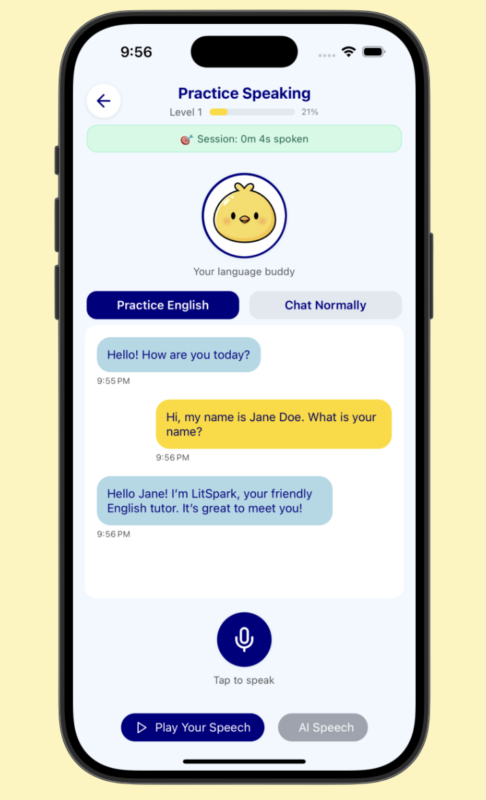
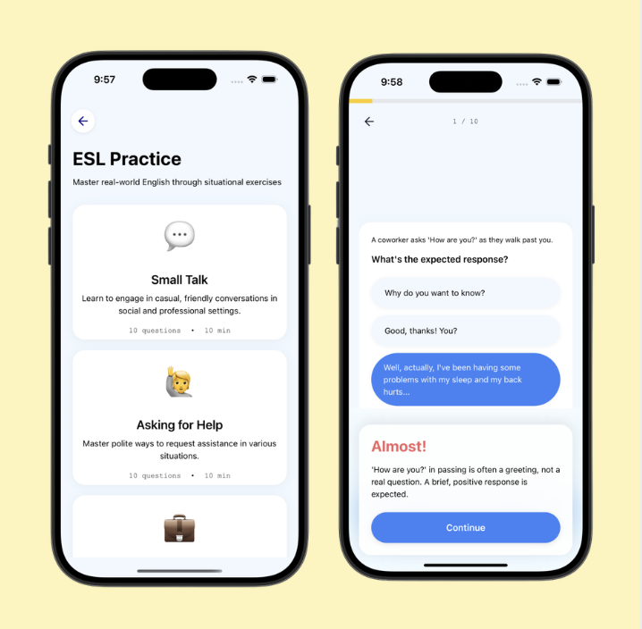
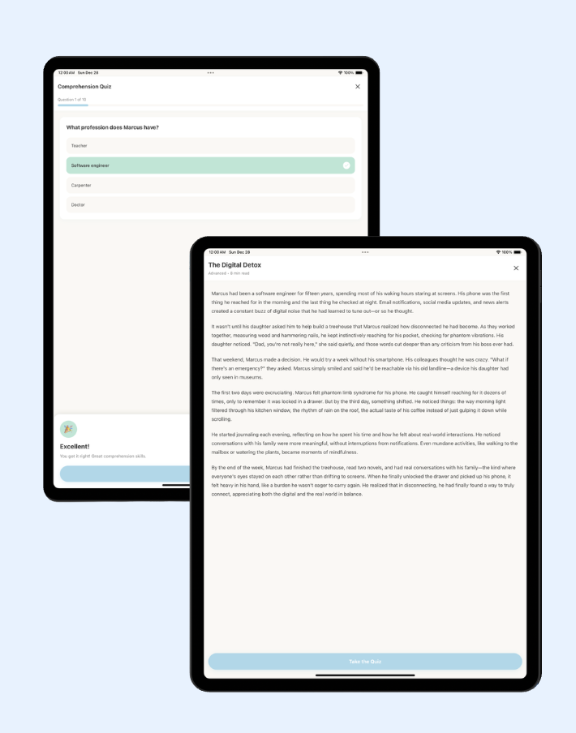

<p align="center">
  
</p>

# LitSpark 📚

A language-learning app I independently built and published on the App Store for **LitSpark**, a youth nonprofit organization.

LitSpark helps English learners build confidence through spoken AI conversations, reading exercises, and practical English for everyday situations.

**[Download on the App Store](https://apps.apple.com/ca/app/litspark/id6757113920)** · [About LitSpark](https://litspark.ca/)

## Features

### Conversational AI 🎙️

Practice speaking aloud with an AI conversation partner in a low-pressure environment. Learners can rehearse conversations and build confidence for real-life interactions.

<p align="center">
  
</p>

### Situational English practice 💬

Learn useful phrases for everyday interactions, including small talk and asking for help. Scenario-based questions and explanations help learners understand what to say and why.

<p align="center">
  
</p>

### Reading exercises 📖

Explore reading passages and test comprehension with quizzes. Gamified learning and encouraging feedback make reading practice more engaging.

<p align="center">
  
</p>

## My Role

I independently built the app and published it on the App Store. My work spans the mobile implementation, integration of the learning activities, and preparation for release.

## Built With

- **React Native** and **Expo** for mobile development
- **TypeScript** for application code
- **Expo Router** for navigation
- **NativeWind** for styling

Related repository: [LitSpark backend](https://github.com/magi-wuu/LSAPP_backend).

## Running Locally

Install Node.js and npm, then run:

```bash
git clone https://github.com/magi-wuu/LitSpark-App.git
cd LitSpark-App
npm install
npx expo start
```

Follow the Expo terminal instructions to open the app on a compatible device or simulator. Backend-dependent features also require the corresponding backend configuration; these commands start the frontend development server.

## About LitSpark

Built for [LitSpark](https://litspark.ca/), a youth nonprofit organization.
